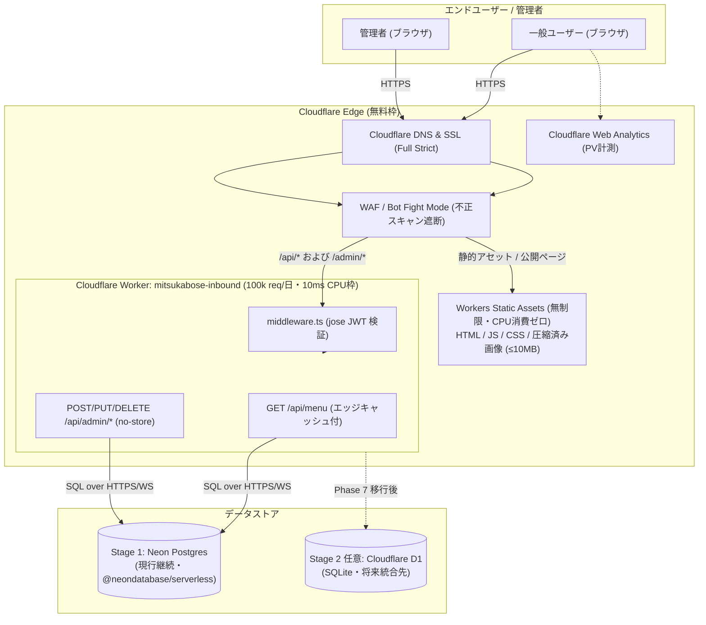

# 02. アーキテクチャ設計および技術決定（ADR）

このドキュメントでは、`InboundWebPage` を Cloudflare Workers Free プランで安全・高速・ゼロコストで運用するためのシステム設計と主要な技術的意思決定（ADR）を定義します。

---

## 1. 移行後システムアーキテクチャ



---

## 2. 技術決定事項（Architecture Decision Records）

### ADR-1: Next.js 実行ランタイム — `vinext`（第一選択）＋ OpenNext（フォールバック）

* **決定**: Cloudflare 公式の Next.js 推奨ガイド（2026年11月現在）に従い、**`vinext` + `cloudflare.config.ts` + `cf` CLI** を第一選択とする（`wrangler setup` は OpenNext を構成するため使用しない）。
* **エージェント実行用フラグ（非対話モード必須）**:
  ```bash
  npx vinext init \
    --platform=cloudflare \
    --name=mitsukabose-inbound \
    --cdn-cache=none \
    --data-cache=none \
    --image-optimization=none
  ```
  * `--cdn-cache=none --data-cache=none`: 本アプリは `export const revalidate` や ISR / `use cache` を使用していないため不要（R2/DO バインディングを作らずシンプルに保つ）。
  * `--image-optimization=none`: Phase 1 で画像を事前圧縮し `images: { unoptimized: true }` を使用するため、Cloudflare Image Transformations を消費しない。
* **フォールバック条件（`@opennextjs/cloudflare` への切替基準）**:
  1. Phase 3 の `npx vinext check` で本番利用を阻害する致命的非互換が検出された場合。
  2. `build:vinext` またはローカル `dev:vinext` スモークテストで解決困難な不具合が 2 回連続発生した場合。
  * 切替時は `wrangler.jsonc` で `"assets": { "run_worker_first": false }` を明示し、静的ファイル配信に Worker CPU を消費させない。

---

### ADR-2: 画像圧縮および配信戦略（最重要改善項目）

* **決定**: **「既存ファイル名・拡張子を維持したままの事前リサイズ＋高効率再圧縮」＋ `images: { unoptimized: true }`** を Phase 1 の標準方針とする。
* **理由**:
  1. Neon DB 内の `menu.payload.imageUrl`（全 73 件）および管理画面 `app/admin/page.tsx`（新規作成時に `/images/menu/${id}.jpg` を自動設定）が **`.jpg` パスを前提** としているため、拡張子を変えずに再圧縮すれば DB 更新なしで安全かつ即座に適用できる。
  2. Cloudflare Image Transformations（月 5,000 ユニーク変換枠）や R2 の追加バケット管理が不要になり、Workers Static Assets（合計 ≤ 10 MB）から最速・完全無料で配信できる。
  3. 2026年9月以降、Workers のバンドル上限は 64 MiB 非圧縮に統一されており、かつ Static Assets は別枠（20,000 ファイル / 1 ファイル最大 25 MiB）であるため容量余裕が圧倒的。

#### ディレクトリ別 画像圧縮目標ポリシー

| ディレクトリ | 現状規模 | 最大長辺リサイズ | 圧縮設定（`sharp` 基準） | 単体サイズ目標 | 圧縮後見込み |
| :--- | :---: | :---: | :--- | :---: | :---: |
| `public/images/hero/` (5枚) | ~19 MB（最大 5.19 MB） | **1920 px** | JPEG (`mozjpeg: true, quality: 80, progressive: true`) ＋ `.rotate()`（EXIF 回転補正） | **≤ 400 KB** | 約 1.0〜1.5 MB |
| `public/images/menu/` (55+枚) | ~33 MB（最大 3.55 MB） | **1200 px** | JPEG (`mozjpeg: true, quality: 78, progressive: true`) ＋ `.rotate()` | **≤ 200 KB** | 約 3.0〜4.5 MB |
| `public/images/food-and-drinks/` (6枚) | ~6.2 MB（`orize-brewing.png` 3.68 MB） | **1400 px** | JPEG は `quality: 80`、PNG は `palette: true, compressionLevel: 9, quality: 80`（大きく下がらない写真 PNG は `.jpg` 変換を人間確認） | **≤ 350 KB** | 約 0.8〜1.5 MB |
| `public/images/access/` | ~340 KB | **1200 px** | JPEG (`mozjpeg: true, quality: 80`) ＋ `.rotate()` | **≤ 200 KB** | 約 150 KB |
| **全体合計** | **58.85 MB（72枚）** | — | **全ファイル 500 KB 以下・メタデータ削除（EXIF 回転のみ保持）** | **最大 ≤ 500 KB** | **合計 ≤ 10 MB（83% 以上削減）** |

> [!TIP]
> **Option B（将来の WebP 全面移行）について**
> さらなる軽量化（合計 3〜5 MB 台）を望む場合は、移行完了後に全ファイルを `.webp` 化し、同時に Neon DB 内の `payload->>'imageUrl'` を SQL で一括置換（`UPDATE menu SET payload = jsonb_set(payload, '{imageUrl}', to_jsonb(regexp_replace(payload->>'imageUrl', '\.(jpe?g|png)$', '.webp', 'i')));`）および `app/admin/page.tsx` の自動 URL 拡張子を更新します。**初回移行では変更範囲を絞るため拡張子維持（Option A）を推奨します。**

#### 欠損・重複画像への対処方針
1. `/images/hero/hero-1.jpg`, `hero-2.jpg` 参照（`app/layout.tsx`, `RestaurantJsonLd.tsx`）: 実在する Hero 画像パス（例: `public/images/hero/` 先頭ファイル）へ差し替えるか、OGP 用 `hero-1.jpg` をリサイズ生成する（Phase 1 で確定）。
2. `/images/logo.png` 参照（`RestaurantJsonLd.tsx`）: 実在するロゴ画像を確認し、未作成なら人間確認の上で生成またはパス修正。
3. `/images/food-and-drinks/japanese-pattern-dark.jpg` 参照（`FoodAndDrinksClient.tsx`, `EventsClient.tsx`）: CSS 背景フォールバックのみで 404 リクエストが発生しているため、画像配置または CSS グラデーションへ置換。
4. `public/images/menu/midnight-tsukemen-6.jpg` / `.jpeg` 重複: JSON・Neon DB の実際の参照先を確認し、未使用側を削除。

---

### ADR-3: データベースおよびキャッシュ戦略（段階的移行）

* **Stage 1（Phase 0〜6）: Neon Postgres 継続**
  * `@neondatabase/serverless` は HTTP / WebSocket 経由で動作するため、Cloudflare Workers ランタイムでもそのまま動作する。
  * 本番 DB データを一切動かさずにホスティング切替できるため、切り戻し（ロールバック）が DNS 戻しだけで即座に完了する。
  * **キャッシュ最適化**:
    * `GET /api/menu` に `Cache-Control: public, s-maxage=300, stale-while-revalidate=600` を付与し、メニュー閲覧のたびに Neon へ再接続しないようにする（管理画面からの更新後は最大 5 分で反映、即時反映が必要なら管理操作後にキャッシュパージまたは `s-maxage=60` へ調整）。
    * `/api/admin/*` には必ず `Cache-Control: private, no-store` を付与し、エッジキャッシュを禁止する。
* **Stage 2（Phase 7・任意）: Cloudflare D1 への完全統合**
  * `akishika_app`（現在 2 DB）と合わせても D1 上限（10 DB）に対し 3 DB のみ、データ量も数十 KB のため完全無料。
  * D1 用 SQLite スキーマ（将来の移行用）：
    ```sql
    CREATE TABLE IF NOT EXISTS menu (
      id TEXT PRIMARY KEY,
      payload TEXT NOT NULL,
      sort_order INTEGER DEFAULT 0
    );
    CREATE INDEX IF NOT EXISTS idx_menu_sort_order ON menu(sort_order, id);
    ```

---

### ADR-4: Workers Free 10 ms CPU 制限対策・セキュリティ・計測

* **10 ms CPU 制限への備え**:
  * 同アカウントの `akishika-user-api` の実測で P99 CPU 時間が **10.15 ms** に達するケースが観測されている。
  * `InboundWebPage` では公開ページの静的配信（Static Assets）を徹底し、動的 Worker 実行を `/api/*` と `/admin/*`（認証判定・DB 読書き）に限定する。
  * `/api/menu` にエッジキャッシュを入れることで、通常アクセス時の Worker 起動と DB 接続 CPU を極小化する。
* **セキュリティ設定**:
  * `next.config.ts` の既存 `securityHeaders`（`X-Frame-Options`, `HSTS`, `nosniff`, `Permissions-Policy`, `Referrer-Policy`）を維持。
  * Cloudflare ダッシュボードで **Bot Fight Mode** および基本 WAF を有効化し、脆弱性スキャン（`/.env` 等）をエッジで遮断（Workers 枠を消費させない）。
  * 既存の `middleware.ts`（`jose` による HS256 JWT Cookie 検証）は Web Crypto ベースのため Workers 上でそのまま動作する。任意で管理画面 `/admin/*` に Cloudflare Zero Trust (Access) を追加することも可能（50 ユーザーまで無料）。
* **アクセス解析**:
  * `@vercel/analytics` を削除し、Cloudflare Web Analytics のビーコンスクリプト（無料・Cookie レス・PV 無制限）へ切り替える。

---

### ADR-5: DNS・ドメイン切替方針（`mitsukabose.jp`）

* **本番ドメイン**: `www.mitsukabose.jp`（およびルート `mitsukabose.jp` → `www.mitsukabose.jp` へのリダイレクト）。
* **メール等の保護**: 現在 `mitsukabose.jp` のネームサーバーは `ns1.vercel-dns.com` / `ns2.vercel-dns.com` を向いている。NS 切替前に**必ず Vercel DNS 上の MX / TXT (SPF・DKIM・Google Search Console 等) / CNAME / A レコードをすべて控え、Cloudflare DNS へ先に登録**してから NS を切り替える。
* **ドメイン表記ゆれ確認**: `lib/siteConfig.ts` および `app/layout.tsx` で `mitsukabose.com` が指定されている点については、Phase 2 で人間確認を取り、必要に応じて `mitsukabose.jp`（または `www.mitsukabose.jp`）へ統一する。
