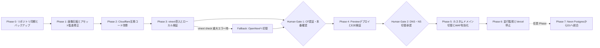

# InboundWebPage Cloudflare 移行計画書

`InboundWebPage`（`mitsukabose.jp` / Next.js 15 App Router）を、Vercel Hobby プランから **`akishika_app` と同一の Cloudflare 無料枠アカウント（Free プラン）** へ移行するための総合計画書です。  
**特定の IDE や MCP ツールに依存せず、どの AI コーディングエージェント（Claude Code / Cursor / Codex / Antigravity / OpenCode / Devin 等）でもそのまま順守・実行できる形式** で構成しています。

---

## 🎯 エグゼクティブサマリー

| 項目 | 現行 (Vercel Hobby + Neon) | 移行後 (Cloudflare Workers Free + Neon / 任意でD1) |
| :--- | :--- | :--- |
| **ホスティング** | Vercel Hobby (`inboundwebpage`) | **Cloudflare Workers (`mitsukabose-inbound`)** + Static Assets |
| **Next.js アダプタ** | Vercel Native Build | **`vinext`（第一選択）** / `@opennextjs/cloudflare`（フォールバック） |
| **データベース** | Neon Postgres (`menu` テーブル・約73件) | **Stage 1:** Neon Postgres 継続（最小リスク切替）<br>**Stage 2（任意）:** Cloudflare D1 へ統合 |
| **画像・静的配信** | `public/images/` **58.85 MB（72枚）** ＋ Vercel 画像最適化 | **事前圧縮（58.85 MB → 10 MB 以下）** ＋ `unoptimized: true` ＋ CDN 無制限配信 |
| **アクセス解析** | `@vercel/analytics` | **Cloudflare Web Analytics**（無料・PV無制限） |
| **DNS / WAF** | Vercel DNS (`ns1/ns2.vercel-dns.com`) | **Cloudflare DNS + WAF / Bot Fight Mode**（無料） |
| **月額追加コスト** | \$0（ただし商用利用・枠拡張に制約） | **\$0（完全無料・`akishika_app` 合算でも無料枠 10% 未満）** |

> [!IMPORTANT]
> **作業開始前の最優先確認事項（Git リポジトリの乖離）**
> 本番 Vercel（`mitsukabose.jp`）は `https://github.com/KotaHarada02/inboundwebpage`（最新コミット `454cb24` / 2026-11-17）からデプロイされていますが、ローカルの `origin` は `https://github.com/MitsukaAnalysisTeam/InboundWebPage.git`（`c5dc206` / 2026-06-04）を向いています。**必ず Phase 0 で最新の本番ソースコードと同期してから画像圧縮や改修に着手してください。**

---

## 📚 ドキュメント一覧

1. **[01_current_state_and_cost.md](./01_current_state_and_cost.md)** — 現状棚卸し・Vercel/Cloudflare 実測メトリクス・無料枠比較・画像アセット監査
2. **[02_architecture_and_decisions.md](./02_architecture_and_decisions.md)** — 移行先アーキテクチャ・技術決定事項（ADR-1〜5：vinext 採用基準、画像圧縮仕様、CPU 10ms 対策、DB/DNS 方針）
3. **[03_agent_runbook.md](./03_agent_runbook.md)** — 汎用 AI エージェント向け実行ランブック（Phase 0〜7 のコマンド・編集箇所・検証コマンド・合格基準・ロールバック手順）
4. **[PHASE0-3_REPORT.md](./PHASE0-3_REPORT.md)** — Phase 0〜3 実施結果（変更内容・画像圧縮結果・テスト結果・残課題）

---

## 🤖 AI エージェント共通作業ルール（Agent Execution Contract）

どの AI エージェントがこのタスクを引き継ぐ場合も、以下の契約（Contract）を必ず順守してください。

1. **ブランチ隔離**: `main` ブランチを直接編集しない。必ず作業用ブランチ（例: `feat/cloudflare-migration`）を作成して作業する。
2. **ツール非依存**: 特別な IDE プラグインや MCP サーバーを前提としない。標準の CLI（`git`, `node`, `npm`, `npx`, `cf` / `wrangler`, `curl`）のみを用いて実行・検証する。
3. **シークレット保護**: `.env*`、`.dev.vars`、`DATABASE_URL`、`ADMIN_PASSWORD`、`AUTH_SECRET`、Cloudflare API トークンの**中身を絶対にログ・出力・コミットへ含めない**（キー名の確認のみ許可）。
4. **原本バックアップ**: Phase 1 の画像圧縮を実行する前に、必ずリポジトリ外（例: `/tmp/inbound-images-backup`）へ `public/images/` の原本バックアップを作成する。
5. **ゲート駆動実行**: 各 Phase は「前提条件 → 実施 → 自動検証コマンド → 合格基準（Pass Criteria）」の順で進め、合格しないまま次の Phase へ進まない。同じエラーで 2 回失敗した場合は自力で推測を続けず、人間に判断を仰ぐ。
6. **Human Gate（人間承認必須アクション）**: 以下の操作は AI エージェントが独断で実行せず、コマンドと影響範囲を提示して**必ず人間の承認・実行**を待つこと。
   - 本番本番環境への初回デプロイおよびシークレット登録（Phase 4）
   - DNS レコード変更・ネームサーバー（NS）切替・SSL 設定変更（Phase 5）
   - DB に対する破壊的変更（テーブル削除、本番データ上書き）
   - Vercel プロジェクトや DNS の停止・削除（Phase 6）

---

## 🗺️ 全体移行フロー図



---

## 📅 マスター移行計画表（Master Schedule）

| Phase | ID | タスク | 実行主体 | 依存 | 主な対象・成果物 | 完了条件（DoD） | 目安時間 |
| :---: | :---: | :--- | :--- | :---: | :--- | :--- | :---: |
| **0** | `P0-1` | 本番リポジトリ（`KotaHarada02/inboundwebpage`）との差分確認・同期 | AI＋人間承認 | — | Git ブランチ `feat/cloudflare-migration` | 本番最新コミット（`454cb24` 以降）をベースにした作業ブランチが存在する | 10分 |
| **0** | `P0-2` | `public/images/` 原本の外部バックアップ取得 | AI自動 | `P0-1` | `/tmp/inbound-images-backup` | `diff -rq` でバックアップと完全一致 | 5分 |
| **0** | `P0-3` | 現行環境変数キー一覧（値なし）と本番 DNS レコード控え | AI＋人間作業 | `P0-1` | `.env.development.local` / Vercel DNS 控 | 必要キー（`DATABASE_URL`, `ADMIN_PASSWORD`, `AUTH_SECRET`）と MX/TXT 控えが完了 | 10分 |
| **1** | `P1-1` | 画像圧縮スクリプト実装・Dry-Run・本番適用（拡張子維持リサイズ圧縮） | AI自動 | `P0-2` | `scripts/compress-images.mjs`, `public/images/**` | `public/images/` 合計 **≤ 10 MB**、全画像 **≤ 500 KB**、EXIF 回転崩れなし | 20分 |
| **1** | `P1-2` | 欠損画像参照・重複ファイル・日本語ファイル名の整理 | AI＋人間確認 | `P1-1` | `app/layout.tsx`, `RestaurantJsonLd.tsx`, `FoodAndDrinksClient.tsx`, `EventsClient.tsx` | 参照切れ URL 0 件（全 `/images/...` が `public/` に実在）、重複 `.jpeg` 解消 | 15分 |
| **2** | `P2-1` | `next.config.js` / `next.config.ts` 統合 ＋ `images: { unoptimized: true }` 設定 | AI自動 | `P1-2` | `next.config.ts`（`next.config.js` 削除） | 設定ファイルが 1 本化され `securityHeaders` と `unoptimized: true` が有効 | 10分 |
| **2** | `P2-2` | `lib/getHeroImages.ts` の `fs.readdirSync` 廃止（静的リスト化） | AI自動 | `P1-2` | `lib/getHeroImages.ts` | アプリ本体から `fs` 依存が消滅し、実在する Hero 画像のみ返却 | 10分 |
| **2** | `P2-3` | `@vercel/analytics` 削除 ＋ API キャッシュヘッダ付与 ＋ `siteConfig.ts` / `app/[lang]` 確認 | AI＋人間確認 | `P2-1` | `package.json`, `app/layout.tsx`, `app/api/menu/route.ts`, `app/api/admin/**` | `@vercel` import が 0 件、`npm run build` & `npm run lint` が成功 | 15分 |
| **3** | `P3-1` | `npx vinext check` による互換性チェック（OpenNext 切替要否判定） | AI自動 | `P2-3` | チェックレポート | 致命的非互換がない（ある場合は OpenNext フォールバックルートへ移行） | 10分 |
| **3** | `P3-2` | `vinext init`・`cloudflare.config.ts` / `tsconfig.json` / ESLint / `.gitignore` 整備 | AI自動 | `P3-1` | `cloudflare.config.ts`, `vite.config.ts`, `tsconfig.json` | Account ID 設定済み、ビルド成果物が Lint/Git 除外済み | 15分 |
| **3** | `P3-3` | `build:vinext` ビルド ＋ `dev:vinext` ローカルスモークテスト | AI自動 | `P3-2` | `.cloudflare/` ビルド出力 | `npm run build:vinext`, `npx tsc --noEmit`, `npm run lint` 合格＆全ルート疎通 | 20分 |
| **4** | `P4-1` | Cloudflare CLI 認証確認 ＋ `--dry-run`（64 MiB 未満確認） | AI＋人間承認 | `P3-3` | Dry-run 出力 | バンドル非圧縮サイズが **64 MiB 未満**（目安 10〜25 MiB） | 10分 |
| **4** | `P4-2` | プレビュー（`*.workers.dev`）デプロイ ＋ シークレット登録 | AI＋人間承認 | `P4-1` | Worker `mitsukabose-inbound` | `DATABASE_URL`, `ADMIN_PASSWORD`, `AUTH_SECRET` 設定済みで起動 | 15分 |
| **4** | `P4-3` | プレビュー環境 E2E テスト（公開・管理画面・画像・CPU 10ms 確認） | AI＋人間確認 | `P4-2` | E2E 検証結果 | 全画面表示・画像表示・`/api/menu` 200・`/admin` CRUD 成功・P99 CPU < 10ms | 20分 |
| **5** | `P5-1` | Cloudflare ゾーン登録（`mitsukabose.jp`）＋ 既存 MX/TXT レコード先行登録 | 人間＋AI支援 | `P4-3` | Cloudflare DNS 設定 | メール等の既存レコード欠落ゼロ | 15分 |
| **5** | `P5-2` | カスタムドメイン紐付け・リダイレクト設定・レジストラ NS 切替 | 人間作業 | `P5-1` | DNS NS (`*.ns.cloudflare.com`) | `https://www.mitsukabose.jp` が Cloudflare 経由で 200、`mitsukabose.jp` がリダイレクト | 20分(+浸透) |
| **5** | `P5-3` | SSL/TLS (Full Strict)・WAF・Bot Fight Mode・Cloudflare Web Analytics 有効化 | 人間＋AI支援 | `P5-2` | セキュリティ・計測設定 | HSTS / WAF 有効、Analytics に計測データ反映 | 15分 |
| **6** | `P6-1` | 1〜2 週間の並行監視（リクエスト数・CPU 時間・5xx・Neon 接続確認） | 人間＋AI支援 | `P5-3` | 監視ログ | 合算 Workers リクエスト < 10万/日、5xx = 0、CPU 超過 0 | 1〜2週間 |
| **6** | `P6-2` | Vercel プロジェクトのデプロイ停止・ドメイン解除 | 人間作業 | `P6-1` | Vercel 設定 | 旧環境クリーンアップ完了（ロールバック不要確定後） | 10分 |
| **7** | `P7-1` | 【任意】Cloudflare D1 作成・SQLite スキーマ適用・データ移行 | AI＋人間承認 | `P6-1` | D1 `inbound-menu-db`, `dbService.ts` | 73 件の並び順・JSON 構造一致、ローカル・本番で D1 読書き成功・Neon 依存解消 | 45分 |

---

## ✅ 進捗チェックリスト（エージェント引き継ぎ用）

エージェントは各タスク完了時にこのチェックリストを更新するか、完了報告に該当 ID を明記してください。

- [x] `P0-1`: 本番最新コミット（`KotaHarada02/inboundwebpage`）同期＆作業ブランチ `feat/cloudflare-migration` 作成
- [x] `P0-2`: `public/images/` の外部バックアップ取得完了
- [x] `P0-3`: 現行環境変数キー一覧＆Vercel DNS 全レコード控え完了（MX/TXT なし。[PHASE0-3_REPORT.md](./PHASE0-3_REPORT.md) 参照）
- [x] `P1-1`: 画像一括圧縮完了（58.85 MB → ≤ 10 MB、最大ファイル ≤ 500 KB）（実績: 7.34 MB / 最大 333 KB）
- [x] `P1-2`: 欠損参照（`hero-1.jpg` 等 4 件）・重複ファイル整理完了（※DB 上の未撮影メニュー画像 31 種類は残課題）
- [x] `P2-1`: `next.config.ts` 一本化・`images: { unoptimized: true }` 設定完了
- [x] `P2-2`: `lib/getHeroImages.ts` 脱 `fs.readdirSync` 完了
- [x] `P2-3`: `@vercel/analytics` 撤去・キャッシュヘッダ付与・Next.js ビルド成功
- [x] `P3-1`: `npx vinext check` 実施＆ルート決定（`vinext` / OpenNext）
- [x] `P3-2`: Cloudflare 用設定（`cloudflare.config.ts` 等）・Lint/TS/Gitignore 更新完了
- [x] `P3-3`: `build:vinext` 成功＆ローカル全ルートスモークテスト合格（Node 24.22.3。[PHASE0-3_REPORT.md](./PHASE0-3_REPORT.md) 参照）
- [x] `P4-1`: `--dry-run` バンドルサイズ < 64 MiB 確認完了（2.13 MiB / gzip 0.63 MiB）
- [x] `P4-2`: `*.workers.dev` デプロイ＆シークレット設定完了（https://mitsukabose-inbound.mitsukabose-system.workers.dev）
- [ ] `P4-3`: `*.workers.dev` E2E・管理画面・CPU 10ms 確認完了（※E2E は合格。**CPU は平均 39 ms で不合格**、書き込みテストは未実施）
- [ ] `P5-1`: Cloudflare ゾーン登録＆既存 DNS レコード再現完了
- [ ] `P5-2`: カスタムドメイン接続＆レジストラ NS 切替完了
- [ ] `P5-3`: SSL Strict・WAF・Bot Fight Mode・Web Analytics 有効化完了
- [ ] `P6-1`: 本番監視（1〜2週間）問題なし
- [ ] `P6-2`: Vercel 停止・クリーンアップ完了
- [ ] `P7-1`: 【任意】Neon Postgres → Cloudflare D1 完全移行完了（※D1 作成・データ投入・コード切り替え済み。DNS 切り替え直前の再同期が残り）

---

## 💬 コピペ用 AI エージェント指示プロンプト

別の AI エージェントへ作業を依頼するときは、以下のプロンプトをそのまま渡してください。

### パターン A: Phase 0〜3（コード改修・画像圧縮・ローカル検証まで）を自律実行させる
```text
@docs/cloudflare-migration/README.md と @docs/cloudflare-migration/03_agent_runbook.md に従って、
Phase 0 〜 Phase 3 を順番に実行してください。

厳守事項:
1. まず Phase 0 の Git リポジトリ同期（本番 Vercel の最新コードとの差分確認）を実施し、
   ローカルが古い場合は作業を進める前に必ず私に確認すること。
2. public/images/ の原本バックアップをリポジトリ外に取ってから Phase 1 の画像圧縮を行うこと。
3. 各 Phase の「検証コマンド」と「合格基準」をすべて満たしてから次へ進むこと。
4. 同じエラーで 2 回失敗した場合は独断で別案へ進まず、原因と選択肢を報告して停止すること。
5. Phase 4 以降の Cloudflare デプロイ・シークレット登録・DNS 変更は絶対に勝手に行わず、
   Phase 3 完了時点で変更ファイル一覧・画像削減結果・検証結果を報告して停止すること。
```

### パターン B: Phase 4（プレビューデプロイ・E2E 検証）以降を実行させる
```text
@docs/cloudflare-migration/03_agent_runbook.md の Phase 4 を実行してください。
私は事前に `npx cf auth login`（または CLOUDFLARE_API_TOKEN の設定）を済ませています。
まず `--dry-run` でバンドルサイズ（64 MiB 未満）を確認して私に報告し、
承認後に `*.workers.dev` へのデプロイと E2E 検証を進めてください。
シークレットの値（DATABASE_URL, ADMIN_PASSWORD, AUTH_SECRET）は絶対に出力しないでください。
```
